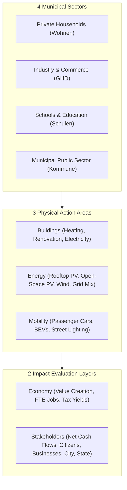

# Calculation Logic, Domain Guide, and Scenario Modeling

This document provides a comprehensive, business-focused description of the calculation methodology, domain interactions, policy measures, and external scenario modeling implemented in `climcalc-core`.

---

## 1. Purpose and High-Level Goal

Local governments and municipalities play a pivotal role in achieving net-zero greenhouse gas targets. However, municipal decision-makers face a dual challenge:
1. **Ecological Impact**: How effectively does a given strategy reduce carbon emissions ($\text{t}\,\text{CO}_2\text{e}$)?
2. **Economic & Financial Realities**: Who pays for the transition? What are the capital requirements, operational savings, local job impacts, and municipal tax consequences?

`climcalc-core` bridges this gap. It is an integrated simulation engine designed for municipal climate action planning (as adopted by [klimarechner.ansvar.com](https://klimarechner.ansvar.com/)). It calculates multi-year transition pathways from a starting year (e.g., 2022) to a target horizon (e.g., 2045) across four municipal sectors:



---

## 2. Measures vs. Scenarios

A central concept in municipal climate modeling is differentiating between **intentional local policy decisions** (Measures) and **uncontrollable macro-environmental conditions** (Scenarios). `climcalc-core` supports both.

```mermaid
graph LR
    subgraph Scenario_Trends ["External World Scenarios (Exogenous Trends)"]
        OIL["Heating Oil & Gas Price Trajectories"]
        FUEL["Fuel Prices (Diesel/Gasoline)"]
        GRID_P["National Electricity Mix Tariffs"]
        GRID_E["National Grid Emission Factors"]
        DEMO["Demographic & Population Trajectories"]
    end

    subgraph Policy_Measures ["Municipal Policy Measures (Active Interventions)"]
        HP["Heat Pump Transition Targets (m² / year)"]
        RENO["Energetic Building Insulation Quotas"]
        PV["Rooftop & Open-Space Solar Expansion"]
        BEV["Electric Vehicle Fleet Electrification Targets"]
    end

    subgraph Core_Engine ["climcalc-core Simulation Engine"]
        CALC["Annual Multi-Stage Evaluation"]
    end

    Scenario_Trends -->|set_input() / baseline curves| Core_Engine
    Policy_Measures -->|new_measure() deltas| Core_Engine
    Core_Engine --> OUT["Emissions, Costs, Jobs, Tax Yields & Cash Flows"]
```

### 2.1 What is a Measure?
A **Measure** represents a concrete, deliberate municipal intervention or policy program designed to change an input parameter over a specific time window.

- **Structure**:
  - `id`: Unique identifier (e.g., `"renovation_offensive_2030"`).
  - `input_id`: Target input variable (e.g., `"buildings/inputs/heat_dmd__k__W_h_per_m2_a/private"`).
  - `start_year`: First year the measure begins phase-in (inclusive).
  - `end_year`: Year in which the full target change is reached.
  - `delta`: The total quantitative change to be applied over the time window.

#### Interpolation and Sign Convention
When a measure is added, `apply_measures()` calculates an annual linear increment:
$$\text{values}[t] = \text{values}[t-1] + \Delta(t)$$

$$\Delta(t) = \frac{\text{delta}}{\text{start\_year} - \text{end\_year} - 1.0}$$

> [!IMPORTANT]
> **Sign Convention Note**:
> Because $(\text{start\_year} - \text{end\_year} - 1.0)$ is negative, the delta has an inverted sign effect:
> - **Positive `delta`** (e.g., `+20.0`): **Decreases** the variable over the period (e.g., reducing space heat demand from 114 to 94).
> - **Negative `delta`** (e.g., `-50.0`): **Increases** the variable over the period (e.g., expanding solar capacity or BEV counts).

Once `end_year` is reached, $\Delta(t)$ drops to 0, and the accumulated change persists constantly for all subsequent years.

### 2.2 What is a Scenario?
A **Scenario** represents how the external world evolves independent of direct local municipal policies. These are contextual drivers and framework assumptions, including:
- **Energy and Fuel Price Trajectories**:
  - Heating oil price (`price_oil__eur_per_L`)
  - Natural gas price (`price_gas__eur_per_m3`)
  - Automotive fuel price (`price_fuel__eur_per_L`)
  - Grid electricity tariffs (`nrg_mix_price__m__eur_per_W_h`)
- **Macro-Demographic & Land Assumptions**:
  - Population numbers per sector (`n_inhabitants__k__`)
  - Total building stock (`n_buildings`)
  - Available roof area (`rf_A__ha`) and open space (`sol_os_installed_A__ha`)
- **Technological & Grid Assumptions** (defined in [`src/constants.rs`](../src/constants.rs)):
  - National grid electricity mix shares (coal, gas, wind, solar)
  - Grid emission factors (`constants::evu_emissions`)
  - Vehicle lifecycle and consumption efficiencies

### 2.3 How Scenarios are Handed Over to the Calculator

Global scenarios can be supplied to the calculator in two distinct ways:

1. **Constant Baseline (Scalar Value)**:
   - Setting a single scalar value via `set_input("price_oil__eur_per_L", 0.85)` or `{ "price_oil__eur_per_L": 0.85 }` in `set_inputs`.
   - The value remains flat across all calculation years unless altered by a policy measure.

2. **Custom Multi-Year Trajectory (Array of Annual Values)**:
   - Providing an annual curve vector matching the simulation year range (from `start_year` to `end_year`, length `end_year - start_year + 1`).
   - Via JavaScript/Wasm direct method:
     ```javascript
     // E.g., simulation from 2020 to 2045 (26 years)
     const oilPriceCurve = [
       0.70, 0.72, 0.80, 0.88, 0.95, 1.05, 1.12, 1.20,
       1.25, 1.30, 1.35, 1.40, 1.45, 1.50, 1.55, 1.60,
       1.65, 1.70, 1.75, 1.80, 1.85, 1.90, 1.95, 2.00, 2.05, 2.10
     ];
     calc.set_input_values("price_oil__eur_per_L", oilPriceCurve);
     ```
   - Via Hierarchical JSON in `set_inputs()`:
     ```json
     {
       "buildings": {
         "price_oil__eur_per_L": [0.70, 0.72, 0.80, 0.88, 0.95, "..."],
         "price_gas__eur_per_m3": [0.08, 0.085, 0.09, 0.10, "..."]
       },
       "mobility": {
         "price_fuel__eur_per_L": [1.45, 1.50, 1.58, 1.65, "..."]
       }
     }
     ```
   - Sector-divided variables can also receive custom trajectories per sector:
     ```json
     {
       "n_buildings": {
         "private": [5000, 5010, 5020, 5030, "..."],
         "industry": [120, 122, 125, 126, "..."]
       }
     }
     ```

### 2.4 Combining Scenarios and Measures
In `climcalc-core`, a scenario establishes the external economic and demographic backdrop (e.g., a "High Fossil Fuel Price" scenario vs. a "Low Price" scenario). 

Policy measures are then layered on top using `new_measure()`. When a measure applies to an input with a custom trajectory, the measure's annual incremental delta compounds on top of the scenario's trajectory curve for each year:
$$\text{final\_value}(t) = \text{base\_trajectory}(t) + \sum \Delta_{\text{measures}}(t)$$

This allows municipal planners to ask:
- *"How does an accelerated heat pump adoption program perform under high gas prices versus low gas prices?"*
- *"At what grid electricity price does local rooftop solar reach municipal cash flow break-even?"*

---

## 3. The 5-Stage Annual Calculation Pipeline

When `calculate_over_years()` is called, the engine processes each year chronologically from `start_year` to `end_year`. Calculations are organized into five interlocked stages:

```mermaid
flowchart TD
    subgraph Stage1 ["Stage 1: Primary Sector Computations"]
        B1["Buildings: Floor area, total heat demand, hot water, appliance electricity, heating consumption by source, heating investments & grants"]
        M1["Mobility: Vehicle-km traveled, BEV fleet demand, ICE fuel demand & costs, BEV subsidies, street lighting"]
        E1["Energy: Rooftop PV, open-space PV & wind potentials, generation, self-consumption, CapEx & subsidies"]
    end

    subgraph Stage2 ["Stage 2: Cross-Domain Sector Coupling"]
        SC1["Aggregate Total Municipal Electricity Demand:\nBuildings Appliance Power + Heat Pump Power + BEV Charging + Streetlights"]
        SC2["Calculate Net Residual Grid Mix Power:\nTotal Demand - Local PV Self-Consumption - Green PPAs"]
        SC3["Compute Municipal Effective Power Tariff:\nnrg_own_mix_price__m__eur_per_W_h"]
        SC4["Feedback Dynamic Power Price into:\n- Heat Pump Electricity Costs (with EVU discount)\n- BEV Charging Costs\n- Streetlight Operating Costs"]
    end

    subgraph Stage3 ["Stage 3: Emissions Accounting"]
        EM1["Buildings Emissions: Oil & Natural Gas combustion CO₂e"]
        EM2["Mobility Emissions: Gasoline/Diesel ICE combustion CO₂e"]
        EM3["Energy Scope 2 Emissions: Residual grid mix electricity CO₂e"]
    end

    subgraph Stage4 ["Stage 4: Macroeconomics & Job Creation"]
        EC1["Split Investments into Hardware/Materials vs. Craftsmanship Labor"]
        EC2["Calculate Local Craft Turnover vs. National Manufacturing Turnover"]
        EC3["Calculate FTE Employment Created (Local Craft & National Industry)"]
        EC4["Calculate Tax Revenues:\nLocal Trade Tax (Gewerbesteuer), Municipal Income Tax Share, Federal VAT & Corporate Tax"]
    end

    subgraph Stage5 ["Stage 5: Stakeholder Financial Balances"]
        ST1["Private Citizens: Heating & fuel savings vs. net investments → Cumulative Cash Flow"]
        ST2["Industry/Commercial: Energy savings + local contractor profits vs. investments → Cumulative Cash Flow"]
        ST3["Municipality: Public building savings + local tax revenues vs. public investments → Cumulative Cash Flow"]
        ST4["Federal State: Additional tax revenues minus federal subsidy outlays"]
    end

    Stage1 --> Stage2
    Stage2 --> Stage3
    Stage3 --> Stage4
    Stage4 --> Stage5
```



---

## 4. Sector-by-Sector Calculation Logic

### 4.1 Buildings Domain ([`src/buildings.rs`](../src/buildings.rs))

1. **Floor Area & Demands**:
   - Total floor area:
     $$\text{floor\_A} = \text{floor\_A\_building} \times \text{n\_buildings} \times 10^{-3}$$
   - Space heat demand and hot water demand are combined:
     $$\text{total\_heat\_dmd} = (\text{n\_inhabitants} \times \text{hot\_water\_dmd} + \text{heat\_dmd} \times \text{floor\_A}) \times 10^{-3}$$
   - Appliance electricity demand:
     $$\text{elec\_dmd} = \text{elec\_dmd\_capita} \times \text{n\_inhabitants} \times 10^{-3}$$
2. **Heating System Mix**:
   - Supported heating types: Oil standard, Oil condensing, Natural Gas, District Heating, Heat Pump, and Other.
   - For each heating technology $i$, final energy consumption is determined by heated floor area and system efficiency $\eta_i$:
     $$\text{cnsmp}_i = \frac{A_i \times (\text{total\_heat\_dmd} / \text{floor\_A})}{\eta_i}$$
   - Efficiencies defined in [`src/constants.rs`](../src/constants.rs):
     - Oil standard: $\eta = 0.87$
     - Oil condensing: $\eta = 0.98$
     - Natural Gas: $\eta = 0.925$
     - District Heating: $\eta = 0.88$
     - Heat Pump: $\text{COP} = 3.0$
     - Other: $\eta = 1.0$
3. **Physical Fuel Units & Costs**:
   - Oil consumption is converted from GWh to million liters via energy density ($9.48\,\text{kWh}/\text{L}$).
   - Gas consumption is converted from GWh to million $\text{m}^3$ via caloric value ($11.0\,\text{kWh}/\text{m}^3$).
   - Annual fuel costs are evaluated against `price_oil__eur_per_L`, `price_gas__eur_per_m3`, and `price_district_heating__m__eur_per_W_h`.
4. **Capital Investments & Subsidies**:
   - For $t > \text{start\_year}$, year-over-year increases in heating area ($A_{i, t} > A_{i, t-1}$) trigger capital expenditure:
     $$\text{invest}_{\text{heat}, i} = 10^{-3} \times (A_{i, t} - A_{i, t-1}) \times \text{cost}_i \times \text{heat\_dmd}_{t-1}$$
   - Reductions in building heat demand ($\text{heat\_dmd}_{t-1} > \text{heat\_dmd}_t$) trigger energetic renovation investments:
     $$\text{invest}_{\text{reno}} = (\text{heat\_dmd}_{t-1} - \text{heat\_dmd}_t) \times \text{cost}_{\text{reno}} \times \frac{\text{floor\_A}}{1000}$$
   - Grants and subsidies are calculated applying statutory subsidy rates (e.g., 30% for heat pumps and energetic renovations).

---

### 4.2 Mobility Domain ([`src/mobility.rs`](../src/mobility.rs))

1. **Mileage & Vehicle Kilometers Traveled**:
   - Mileage per passenger car is derived from inhabitant count, car ownership, travel distance per person, occupancy rate, and modal split:
     $$\text{traveld\_dist\_car} = \frac{\text{n\_inhabitants}}{\text{n\_cars}} \times \text{traveld\_dist\_per\_person} \times \frac{\text{modal\_split\_car}}{\text{mean\_persons\_per\_car}}$$
2. **BEV Fleet vs. Internal Combustion (ICE)**:
   - BEV electricity consumption ($15.65\,\text{kWh}/100\,\text{km}$):
     $$\text{bev\_elec\_nrg\_dmd} = \text{n\_bev} \times \text{traveld\_dist\_car} \times \text{cnsmp}_{\text{bev}} \times 10^{-2}$$
   - Internal combustion fuel demand:
     $$\text{cars\_fuel\_dmd} = (\text{n\_cars} - \text{n\_bev}) \times \text{traveld\_dist\_car} \times \frac{\text{cnsmp}_{\text{ice}}}{\text{energy\_density}_{\text{fuel}}} \times 10^{-2}$$
   - ICE fuel costs are computed from `price_fuel__eur_per_L`.
   - New BEV additions trigger federal vehicle grants ($9,000\,\text{EUR}$ per BEV).
3. **Municipal Street Lighting**:
   - Power demand and maintenance are computed from lantern counts (`n_sl__k__`), consumption per lantern, and unit maintenance costs.

---

### 4.3 Energy Domain ([`src/energy.rs`](../src/energy.rs))

1. **Renewable Generation Potentials**:
   - **Rooftop Solar PV**: Evaluated from roof area (`rf_A__ha`), suitable share, installed capacity (`sol_rf_installed__M__Wp`), and solar yield ($828.75\,\text{kWh}/\text{kWp}\cdot\text{a}$).
   - **Ground-Mounted Open-Space Solar PV**: Evaluated from land area (`sol_os_installed_A__ha`), power density, and solar yield ($1,105\,\text{kWh}/\text{kWp}\cdot\text{a}$).
   - **Onshore Wind Power**: Evaluated from turbine land area (`wind_installed_A__ha`), power density, and wind yield ($1,800\,\text{kWh}/\text{kWp}\cdot\text{a}$).
2. **On-Site Self-Consumption vs. Feed-In**:
   - Generation is split into self-consumption (`sol_rf_self_cnsmp_part`) and grid feed-in.
   - Surplus electricity fed into the grid generates revenue based on buyback feed-in tariffs (`constants::buyback_price`).
3. **Cross-Sector Energy Coupling (Stage 2)**:
   - Total municipal power demand aggregates:
     $$\text{elec\_nrg\_dmd} = \text{elec\_buildings} + \text{elec\_heat\_pumps} + \text{elec\_bev} + \text{elec\_streetlights}$$
   - Residual grid electricity purchased after subtracting local self-consumption and contracted green PPAs:
     $$\text{prchsd\_nrg\_mix} = \text{elec\_nrg\_dmd} - \text{self\_cnsmp}_{\text{roof}} - \text{self\_cnsmp}_{\text{ground}} - \text{prchsd\_green\_ppa}$$
   - The municipal blended electricity procurement price is dynamically calculated:
     $$\text{nrg\_own\_mix\_price} = \frac{\text{Costs}_{\text{PPA}} + \text{Costs}_{\text{GridMix}} + \text{O\&M}_{\text{Solar}} - \text{Revenues}_{\text{FeedIn}}}{\text{elec\_nrg\_dmd}}$$
   - This dynamic price is fed back to determine the operating expenses of electric heat pumps and electric vehicles.

---

### 4.4 Macroeconomic & Job Creation Model ([`src/economy.rs`](../src/economy.rs))

Capital expenditures from heating replacements, insulation renovations, rooftop solar, and ground-mounted solar drive macroeconomic effects:
1. **Material vs. Work Splits**:
   - Investments are divided into equipment/hardware materials vs. manual craftsmanship and installation labor.
2. **Local vs. National Value Added**:
   - Labor primarily stimulates the **local craft sector** (installers, roofers, heating technicians).
   - Equipment and materials stimulate **national manufacturing** (heat pump manufacturers, solar panel producers).
3. **Employment Creation (FTEs)**:
   - Direct and indirect full-time equivalent (FTE) jobs created are computed using turnover-to-employment coefficients:
     $$\text{n\_jobs} = \text{turnover} \times \text{FTE\_per\_million\_turnover}$$
4. **Tax Yields**:
   - **Municipal Level**: Local Trade Tax (*Gewerbesteuer*, via municipal collection rate) and the municipal share of Income Tax (*Gemeindeanteil an der Einkommensteuer*, 15% of wage tax).
   - **National Level**: Federal Value Added Tax (VAT / *Umsatzsteuer*), federal income tax, and corporate tax.

---

### 4.5 Stakeholder Financial Net Cash Flows ([`src/stakeholders.rs`](../src/stakeholders.rs))

For each year, the engine assesses net cash flows across four stakeholder groups by contrasting capital investments against annual operational savings relative to the initial baseline year $\text{start\_year}$:

$$\Delta \text{OpEx}(t) = \text{OpEx}(\text{start\_year}) - \text{OpEx}(t)$$

$$\text{NetCashFlow}(t) = \Delta \text{OpEx}(t) - \text{NetCapEx}(t)$$

1. **Private Households (`private`)**:
   - CapEx: Heating system replacement and rooftop PV (net of subsidies).
   - OpEx Savings: Reductions in heating oil, natural gas, and gasoline expenses, balanced against heat pump power bills.
   - Cumulative net balance: Tracks homeowner payback period.
2. **Industry & Commercial Sector (`industry`)**:
   - CapEx: Commercial building efficiency and large-scale solar installations.
   - Gains: Energy cost reductions plus commercial operating margins from local transition works executed by contractors.
3. **Municipality / Community (`community`)**:
   - Covers public buildings, schools, and street lighting.
   - Gains: Lower public energy bills plus incremental tax revenues (local trade tax and local income tax share).
4. **Federal Government (`federal`)**:
   - Outlays: Subsidy programs for heat pumps, energetic renovations, solar, and electric vehicles.
   - Inflows: Higher national tax yields (VAT from construction, corporate income tax, wage tax).

---

## 5. Summary Table: Input and Output Reference

Below is a consolidated summary of key parameters across the system. For unit conventions and encoding syntax, see [Variable Naming Convention](../variables_naming_convention.md).

| Domain | Key Inputs (`/inputs/...`) | Key Outputs (`/results/...`) | Primary Physical Units |
| :--- | :--- | :--- | :--- |
| **Buildings** | `n_buildings`, `floor_A_building__m2`, `heat_dmd__k__W_h_per_m2_a`, `A_heat_*`, `price_oil__eur_per_L`, `price_gas__eur_per_m3` | `floor_A__k__m2`, `total_heat_dmd__G__W_h_per_a`, `cnsmp_oil__M__L_per_a`, `costs_total__M__eur`, `invest_heat_sources__M__eur_per_a`, `ems_oil__k__to_coe_per_a` | $\text{m}^2$, $\text{kWh}/(\text{m}^2\cdot\text{a})$, $\text{GWh}/\text{a}$, $\text{M€}/\text{a}$, $10^3\,\text{t}\,\text{CO}_2\text{e}/\text{a}$ |
| **Energy** | `rf_A__ha`, `sol_rf_installed__M__Wp`, `sol_os_installed_A__ha`, `wind_installed_A__ha`, `prchsd_renewable_nrg__G__W_h_per_a`, `nrg_mix_price__m__eur_per_W_h` | `sol_rf_nrg__G__W_h_per_a`, `sol_os_nrg__G__W_h_per_a`, `wind_nrg__G__W_h_per_a`, `elec_nrg_dmd__G__W_h_per_a`, `nrg_own_mix_price__m__eur_per_W_h`, `prchsd_nrg_mix_ems__k__to_coe_per_a` | $\text{ha}$, $\text{MW}_{\text{peak}}$, $\text{GWh}/\text{a}$, $\text{EUR}/\text{kWh}$, $10^3\,\text{t}\,\text{CO}_2\text{e}/\text{a}$ |
| **Mobility** | `n_cars__k__`, `n_bev__k__`, `traveld_dist_per_person__m__m_per_a`, `modal_split_car`, `n_sl__k__`, `price_fuel__eur_per_L` | `traveld_dist_car__M__m_per_a`, `bev_elec_nrg_dmd__G__W_h_per_a`, `cars_fuel_dmd__M__L_per_a`, `cars_fuel_costs__M__eur_per_a`, `cars_ems__k__to_coe_per_a`, `sl_total_costs__M__eur_per_a` | $10^3\,\text{cars}$, $10^6\,\text{km}/\text{a}$, $\text{GWh}/\text{a}$, $10^6\,\text{L}/\text{a}$, $\text{M€}/\text{a}$, $10^3\,\text{t}\,\text{CO}_2\text{e}/\text{a}$ |
| **Economy** | *(Driven by investments from Buildings and Energy)* | `turnover_local`, `turnover_national`, `n_jobs_crafting_local`, `n_jobs_production_national`, `business_tax_local`, `income_tax_local`, `turnover_tax_national` | $\text{M€}/\text{a}$, $\text{FTE}$ (full-time jobs) |
| **Stakeholders** | *(Driven by operational savings vs. start year investments)* | `private_cash_flow_netto`, `industry_cash_flow_netto`, `community_cash_flow_netto`, `federal_cash_flow_netto` | $\text{M€}$ (cumulative net cash flow) |
