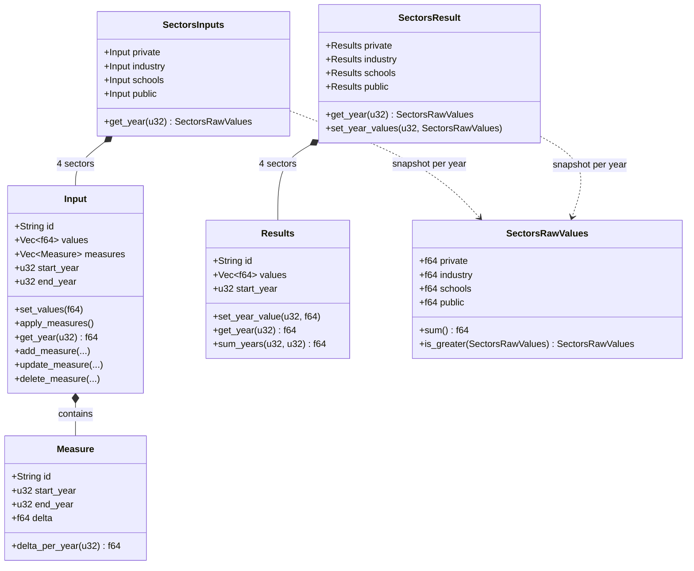
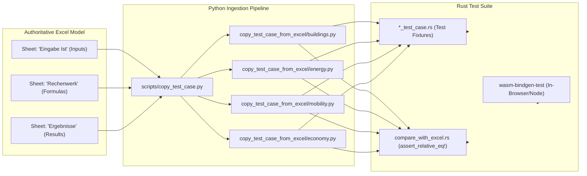

# Technical Architecture & Rust Setup Guide

This document describes the technical architecture, WebAssembly (Wasm) integration, type system, and testing pipeline of `climcalc-core`.

---

## 1. Rust Toolchain & Build System

The core engine is written in Rust (2018 edition) and designed to compile both as a standard native library (`rlib`) for native testing and as a dynamic WebAssembly library (`cdylib`) for integration into web applications and Node.js environments.

### 1.1 `Cargo.toml` Configuration
Key crate configuration from [`Cargo.toml`](../Cargo.toml):
- **Crate Types**: `crate-type = ["cdylib", "rlib"]`
- **Dependencies**:
  - `wasm-bindgen` (`0.2.63`, with `serde-serialize`): Generates bindings between Rust and JavaScript.
  - `serde` (`1.0`, with `derive`): Data serialization/deserialization.
  - `serde-wasm-bindgen` (`0.4`): High-performance serialization bridging Rust data structures and JS `JsValue`.
  - `console_error_panic_hook`: Optional debug feature routing Rust panics to the browser's `console.error`.
  - `web-sys`: Web API bindings (used for browser console logging).
- **Release Profile**:
  - `opt-level = "s"`: Optimizes the binary for minimal Wasm bundle size.

### 1.2 Compiling to WebAssembly
To build the Wasm package for web/frontend usage:
```bash
wasm-pack build
```
This generates a `pkg/` directory containing:
- The compiled WebAssembly binary (`climcalc_core_bg.wasm`)
- JavaScript glue code (`climcalc_core.js`)
- TypeScript type definitions (`climcalc_core.d.ts`)
- A generated `package.json` ready for npm or local workspace consumption.

---

## 2. WebAssembly Integration & JavaScript Bridge

Due to the dynamic nature of municipal planning tools with dozens of variables and sectors, the Wasm bridge uses a **string ID interface protocol** rather than exposing hundreds of individual Rust struct properties.

### 2.1 The `Calculator` Struct
The main interface exposed via `#[wasm_bindgen]` in [`src/lib.rs`](../src/lib.rs) is:

```rust
#[wasm_bindgen]
pub struct Calculator {
    buildings: Buildings,
    mobility: Mobility,
    energy: Energy,
    economy: Economy,
    stakeholders: Steakholders,
    pub start_year: u32,
    pub end_year: u32,
}
```

### 2.2 JavaScript / TypeScript Lifecycle
Frontend applications (such as [klimarechner.ansvar.com](https://klimarechner.ansvar.com/)) interact with the calculator following a strict five-step lifecycle:

```typescript
import { Calculator } from "climcalc-core";

// 1. Initialize calculator with the year range (inclusive)
const calc = Calculator.new(2022, 2045);

// 2. Populate input variables (baseline status quo / scenarios)
calc.set_input("buildings/inputs/n_buildings/private", 44000.0);
calc.set_input("energy/inputs/sol_rf_installed__M__Wp/private", 36.26);

// 3. Define climate action measures (policy interventions)
// Signature: (measure_id, input_id, start_year, end_year, delta)
calc.new_measure("pv_expansion", "energy/inputs/sol_rf_installed__M__Wp/private", 2024, 2035, -20.0);

// 4. Trigger the multi-stage annual calculation
calc.calculate_over_years();

// 5. Query time-series results (returns Array<number> with one value per year)
const co2Emissions = calc.get_results("buildings/results/ems_oil__k__to_coe_per_a/private");
const netCashFlow = calc.get_results("stakeholders/results/private_cash_flow_netto");
```

### 2.3 ID Path Convention & Routing
String IDs follow a hierarchical slash-delimited URI pattern:
- **Sector-specific inputs**: `<domain>/inputs/<variable_name>/<sector>`
  *(e.g., `buildings/inputs/heat_dmd__k__W_h_per_m2_a/private`)*
- **Scalar inputs**: `<domain>/inputs/<variable_name>`
  *(e.g., `mobility/inputs/price_fuel__eur_per_L`)*
- **Sector-specific results**: `<domain>/results/<variable_name>/<sector>`
  *(e.g., `energy/results/sol_rf_nrg__G__W_h_per_a/industry`)*
- **Scalar/Aggregate results**: `<domain>/results/<variable_name>`
  *(e.g., `economy/results/n_jobs_crafting_local` or `stakeholders/results/community_cash_flow_netto`)*

The root [`Calculator`](../src/lib.rs) splits IDs on `/`, routing domain prefixes (`buildings`, `energy`, `mobility`, `economy`, `stakeholders`) to the respective module, which delegates to the appropriate sector field.

---

## 3. Type System & Internal Logic

The codebase uses a domain-driven type hierarchy designed for vectorized multi-sector time-series modeling.



### 3.1 Time-Series Vectors: `Input` and `Results`
- **[`Input`](../src/input.rs)**: Stores the baseline value and any active policy measures. `values` is a `Vec<f64>` of length `(end_year - start_year + 1)`. When measures are added, updated, or removed, `apply_measures()` recalculates the entire time vector.
- **[`Results`](../src/result.rs)**: Stores computed outputs per year. Offers `get_year(year)` and `sum_years(start, end)` (used for cumulative indicators such as historical PV installations for maintenance estimation).

### 3.2 Sector Abstractions: `SectorsInputs` and `SectorsResult`
Municipal modeling requires identical logic across the four sectors (`private`, `industry`, `schools`, `public`):
- **[`SectorsInputs`](../src/sectors.rs)** holds four `Input` fields.
- **[`SectorsResult`](../src/sectors.rs)** holds four `Results` fields.

### 3.3 Vectorized Annual Computation: `SectorsRawValues`
Rather than looping over sectors in every equation, [`SectorsRawValues`](../src/sectors.rs) acts as a single-year 4D vector:
```rust
#[derive(Copy, Clone)]
pub struct SectorsRawValues {
    pub private: f64,
    pub industry: f64,
    pub schools: f64,
    pub public: f64,
}
```
It implements operator overloading (`+`, `-`, `*`, `/`) between `SectorsRawValues` and with `f64` scalars.

#### Vector Masking (`is_greater`)
To prevent negative investments when capacities decline, `SectorsRawValues::is_greater(&other)` returns a mask vector where each element is `1.0` if `self > other` and `0.0` otherwise:
```rust
pub fn is_greater(&self, other: &SectorsRawValues) -> SectorsRawValues {
    SectorsRawValues {
        private: (self.private > other.private) as usize as f64,
        industry: (self.industry > other.industry) as usize as f64,
        schools: (self.schools > other.schools) as usize as f64,
        public: (self.public > other.public) as usize as f64,
    }
}
```
This enables branchless, declarative investment calculations:
```rust
let invest = 1e-3 * (&capacity_now - &capacity_prev) * unit_cost * capacity_now.is_greater(&capacity_prev);
```

### 3.4 Metaprogramming via Declarative Macros
To eliminate boilerplate across dozens of fields, the codebase uses declarative `macro_rules!` extensively:
- `implement_inputs_buildings!`, `implement_results_builidngs!` ([`src/buildings.rs`](../src/buildings.rs))
- `implement_inputs_energy!`, `implement_results_energy!` ([`src/energy.rs`](../src/energy.rs))
- `implement_inputs_mobility!`, `implement_results_mobility!` ([`src/mobility.rs`](../src/mobility.rs))
- `implement_economy!` ([`src/economy.rs`](../src/economy.rs))
- `implement_stakeholders!` ([`src/stakeholders.rs`](../src/stakeholders.rs))

These macros automatically generate the containing struct, initialize all fields with proper ID paths, implement `get_inputs()` / `get_results()`, and generate string-matching dispatch tables for `get_input_by_id()` and `get_results_by_id()`.

---

## 4. Testing Architecture & Verification Pipeline

`climcalc-core` employs a multi-tiered test architecture ensuring both code correctness and exact mathematical equivalence to reference municipal spreadsheet models.



### 4.1 Test Hierarchy
1. **Unit Tests**:
   - Test basic primitives such as time-vector indexing ([`src/input.rs`](../src/input.rs)), vector math comparison ([`src/sectors.rs`](../src/sectors.rs)), and ID lookups.
   - Run via standard cargo:
     ```bash
     cargo test
     ```
2. **Domain Integration Tests (`compare_with_excel.rs`)**:
   - Each domain (`buildings`, `energy`, `mobility`, `economy`) contains a `compare_with_excel.rs` test suite.
   - Sets up a full municipal model (`create_buildings()`, `create_energy()`, `create_mobility()`), runs `calculate_over_years()`, and executes hundreds of `approx::assert_relative_eq!` assertions comparing every single output variable and year against the reference Excel values (typically with `max_relative = 1e-3`).
   - Run targeting specific test modules:
     ```bash
     cargo test --tests test_buildings_calculate
     cargo test --tests test_energy_calculate
     cargo test --tests test_mobility_calculate
     cargo test --tests test_economy_calculate
     ```
3. **Wasm In-Browser Tests**:
   - Configured in [`src/lib.rs`](../src/lib.rs) using `wasm_bindgen_test`:
     ```rust
     #[wasm_bindgen_test]
     fn test_calculator() { ... }
     ```
   - Executes inside a headless browser environment (Node.js or Chrome/Firefox via `wasm-pack test`).

### 4.2 Excel Test Ingestion Pipeline
When domain experts update the mathematical specifications in the authoritative Excel workbook:
1. The conda environment defined in [`environment.yml`](../environment.yml) provides Python 3.11 with `pandas` and `openpyxl`.
2. Running [`scripts/copy_test_case.py`](../scripts/copy_test_case.py):
   ```bash
   python scripts/copy_test_case.py <path_to_excel_model.xlsx>
   ```
3. The script:
   - Reads the baseline status quo from sheet `"Eingabe Ist"`.
   - Reads the policy measures from sheet `"Ergebnisse"`.
   - Generates the Rust fixture setup code in `src/<domain>/tests/<domain>_test_case.rs`.
   - Reads computed matrices from sheet `"Rechenwerk"` and generates all `assert_relative_eq!` blocks in `src/<domain>/tests/compare_with_excel.rs`.

This automated pipeline eliminates manual copy-pasting of test tolerances and ensures strict parity between the financial spreadsheet specifications and the compiled Rust/Wasm implementation.
